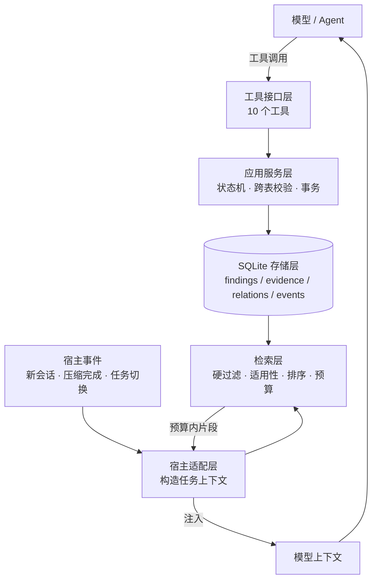

  

<h1 align="center">Finding Ledger · 发现账本</h1>

  面向长程故障排查的<b>证据化发现账本</b> —— 在上下文压缩、换会话、任务切换之后，只把「仍然相关、且适用条件仍然成立」的发现重新交回模型。

  
  
  

  
  
  
  

> **状态说明：** 本仓库的核心资产是[设计契约](docs/README.md)。下文用三档措辞区分：**首期范围**（设计已确定、属于第一阶段实现目标）、**路线图**（按 P0–P3 排期）、**首期不做**（有意排除）。某项能力是否已经落地，请以代码与测试为准；设计文档描述的是目标行为，不是已经上线的功能清单。

## 它解决什么问题

长程排查失败，多数时候不是模型不够聪明，而是**推理连续性断了**。具体表现为三个可复现的失败模式：

| 失败模式 | 现场长什么样 |
|---|---|
| **压缩后遗忘** | 排查进行到第 40 轮，上下文压缩把「已经用 4 个探针排除了 tokenizer shift」这段历史压掉。模型从零开始，把同样的探针又跑了一遍。 |
| **假设当事实** | 某句「大概是权重同步路径的问题」的直觉被摘要记成了结论，两轮之后它已经变成「确定是权重同步问题」—— 而这中间从未出现过证据。 |
| **条件变化后误用** | 结论是在特定 commit / 推理后端 / dtype 下得到的。切换分支或换后端之后，旧结论被当成仍然有效的当前事实直接套用。 |

Finding Ledger 的做法不是「记住更多对话」，而是把排查过程中真正可复用的部分 —— **发现（finding）**：观察、诊断、约束、决策、步骤 —— 连同它的证据、适用条件、状态变化和演化历史一起持久化到本地 SQLite，并在恰当的时机按**确定性规则**检索、按 token 预算注入。

它不做完整的会话记忆系统，也不做文档检索系统；它保存的是「当前还值得相信、以及在什么条件下值得相信」的工程结论。

### 与相邻机制的分工

| 机制 | 负责什么 |
|---|---|
| 工作日志 | 事件顺序与任务归因 |
| `AGENTS.md` / `CLAUDE.md` | Agent 应遵循的项目规则与工作流程 |
| 项目设计文档 | 系统设计、接口与使用方式 |
| **Finding Ledger** | 工程发现、证据、适用范围及其演化历史 |

## 核心设计

### 三个正交的状态

整个设计的不变量：一条 finding 同时被三个维度描述，**任何两个都不能替代第三个**。

| 维度 | 取值 | 回答的问题 |
|---|---|---|
| `epistemic_state` 认知状态 | `unassessed` · `provisional` · `supported` · `contested` · `refuted` · `inconclusive` · `not_applicable` | 现有证据是支持、反驳，还是不足以判断这条主张？ |
| `lifecycle_state` 生命周期 | `current` · `superseded` · `withdrawn` · `archived` | 这条记录在当前账本里处于什么位置？ |
| 适用性 applicability | `applicable` · `conditional` · `needs_revalidation` · `incompatible` · `unknown` | 在当前项目 / 版本 / 环境 / 任务下，这条结论能不能直接用？ |

三条不能让步的约束：

- **`epistemic_state` 里没有 `verified`，也没有 `user-confirmed`。** 这两个值把「谁说的」和「有多少证据」混成了一个字段。用户陈述是证据的一种来源，以 `source_kind = user_statement` 单独保存；没有证据的结论只能是 `provisional`，不是事实。
- **`refuted` ≠ `superseded`。** 被反证的假设通常仍处于 `current` 生命周期，保留为「已排除路径」：知道「这条路走不通」和知道「正确做法」同等重要，否则长程排查会反复回到已经被排除的分支。反过来，被取代的结论也不一定是错的，它可能只是适用于旧版本。
- **条件不明确不得默认适用。** 判断不了就落到 `unknown` / `needs_revalidation`，不能让缺失信息被静默当成匹配成功。

同一套三维度看几个典型场景：

| 场景 | epistemic | lifecycle | 当前任务适用性 |
|---|---|---|---|
| 旧版本实验已证实某现象 | `supported` | `current` | 版本不同则 `needs_revalidation` |
| 某种根因已被排除 | `refuted` | `current` | 只对匹配的实验条件有效 |
| 旧分析被新分析取代 | 可能仍 `supported`，也可能 `refuted` | `superseded` | 作为历史记录，不作为当前主结论 |
| 用户要求本轮只用 GPU 0–3 | `not_applicable` | `current` | 在约束作用范围内适用 |
| 两组证据互相冲突且未解决 | `contested` | `current` | 不得以肯定语气注入 |

配套字段：`claim_kind`（`observation` / `diagnosis` / `constraint` / `decision` / `procedure`，描述内容性质，**不表示证据强度**）与 `retrieval_policy`（`always` / `relevant` / `on_demand` / `never`）。`always` 不是全局广播，它同样受项目隔离、scope 与 token 预算约束。

### 证据是一等公民

一条 finding 的可信度不能被「语句写得像事实」制造出来，所以证据是独立实体：

- **`evidence`** 描述来源本身：`source_kind`（log / file / experiment_run / git_commit / user_statement / …）、`source_ref` 定位符、`locator`、`revision`、`excerpt`、`content_hash`。
- **`finding_evidence`** 描述这份来源对某条主张起什么作用：`supports` / `contradicts` / `context`，并记录 `method`（experiment / code_inspection / runtime_observation / user_assertion / …）与 `rationale`。同一份证据可以支持 A 的同时反驳 B，所以这个关系不能压成 evidence 表上的一个布尔值。
- **`supported` 必须至少有一条支撑证据。** 这条跨表约束由服务层校验 —— SQL 的 `CHECK` 表达不了跨表条件，所以不能只靠 schema 兜底。
- **来源类型不自动等于可信度**：`source_kind = log` 也可能是采集错误或不完整的日志，代码也可能被读错，实验也可能存在混杂因素。
- **`finding_relations`**：`supersedes` / `derived_from` / `contradicts` / `duplicate_of` / `related_to`；服务层拒绝自环和取代环，`supersedes` 的方向固定为「新 → 旧」。
- **`finding_events`** 是只追加的审计日志（actor 分 `user` / `agent` / `system`），状态、scope、关系的关键变化必须留下理由与 before/after 摘要，而不是靠静默覆盖。
- **`doc_links` + `promotion_state`** 为「把发现沉淀成 `AGENTS.md` 规则」预留接口：提议、批准、拒绝、落地是四个不同状态，**首期不会自动修改任何文档**。

### 十个工具

工具名表达业务语义，而不是暴露通用 CRUD。所有返回共用同一个信封 `{ ok, data, warnings, error }`。

| 工具 | 用途 | 读写 |
|---|---|---|
| `log_finding` | 新建 finding，可同时写入初始证据关联 | 写 |
| `query_findings` | 按项目 / 关键词 / 标签 / 状态 / scope 检索，并返回适用性判定 | 读 |
| `get_finding` | 取单条 finding 的完整证据、关系、事件与文档链接 | 读 |
| `add_evidence` | 新增证据来源并关联到已有 finding | 写 |
| `set_finding_state` | 在允许的状态转换内变更认知状态（需 reason） | 写 |
| `refute_finding` | 反证：写入反证证据 + 变更状态 + 记录事件，同一事务完成 | 写 |
| `supersede_finding` | 新建替代 finding 并关闭旧记录的当前生命周期，同一事务完成 | 写 |
| `revalidate_finding` | 追加当前条件下的重新验证结果 | 写 |
| `link_finding` | 在两条 finding 之间建立关系（`supersedes` / `derived_from` / `contradicts` / `duplicate_of` / `related_to`） | 写 |
| `propose_rule` | 提议把 finding 沉淀为项目规则（提议 ≠ 落盘） | 写 |

实现另附一个只读诊断工具 `ledger_status`，用于排查「为什么注入没有出现」：它报告账本路径、记录数、当前修订号、各类注入触发计数与最近一次注入结果。它不属于上表的业务工具契约。

失败时返回稳定错误码：`INVALID_ARGUMENT`、`NOT_FOUND`、`PROJECT_SCOPE_MISMATCH`、`INVALID_STATE_TRANSITION`、`EVIDENCE_REQUIRED`、`RELATION_CYCLE`、`CONCURRENT_MODIFICATION`、`STORAGE_ERROR`。错误消息可以带定位建议，但不能泄露内部路径或其他项目的敏感片段。

### 五层架构

- **工具接口层**：把模型意图翻译成可验证的业务操作，参数用 JSON Schema 约束。
- **应用服务层**：状态机、跨表约束、事务边界与审计事件都在这一层；模型生成的描述不能替代这里的校验。
- **存储层**：单机 SQLite，保存主张、来源、关系与事件。
- **检索层**：按项目、适用范围、任务相关性与 token 预算挑出记录。
- **宿主适配层**：接收 DSH 会话事件，并在上下文装配点注入结果。

为什么是 **DSH 插件**而不是独立服务：排查的连续性发生在会话内部，「压缩完成」这个时机只对宿主可见。离开宿主事件，就不存在正确的注入点。

## 检索与注入

检索层的目标不是把历史全量重新注入，而是为当前任务构造一个**短、相关、适用范围明确、证据可追溯**的上下文片段。首期使用可解释的确定性规则：向量相似度不能决定一条结论是否适用或是否正确。

1. **建立任务上下文** —— project_id、当前任务目标、可获得的 branch / commit / backend / dtype、剩余 token 预算。拿不到的字段标 `unknown`，不让模型自行脑补环境值。
2. **硬过滤** —— 项目隔离；排除 `superseded` / `withdrawn` / `archived`（历史查询除外）；排除 `retrieval_policy = never`；排除 scope 硬冲突。注意：`refuted` 且 `current` 的记录**不能**在这一步被排除，它正是「已排除路径」的来源。
3. **适用性分类** —— 为每个候选判定 `applicable` / `conditional` / `needs_revalidation` / `incompatible` / `unknown`。
4. **排序** —— 适用性 → `retrieval_policy` → 任务相关性 → 认知状态 → 实用价值 → 简洁度。**不做模型自填的 0–1 置信度**；需要打分时记录分项分数与规则版本，便于离线评估。
5. **关系处理** —— `contested` 显式并列冲突双方；`refuted` 归入「已排除路径」；`superseded` 只保留关系摘要；`duplicate_of` 只注入规范记录。
6. **预算裁剪与格式化** —— 每条必须包含 finding ID、主张、两个状态、适用条件、一句证据摘要与来源定位符；超预算时优先删除低相关历史细节，**状态字段不允许被截断**；裁到无法正确解释时整条省略，只留按 ID 查询的入口。

### 注入格式

括号内是 `[finding_id | epistemic_state | applicability]`；`lifecycle_state` 仅在非 `current` 时额外标注。

~~~text
## Finding Ledger：当前任务相关发现

### 当前有证据支持
- [F-123 | supported | applicable]
  结论：探针 A 的结果不支持 off-by-one 是主因。
  依据：实验 run-4472；shift -1/0/+1 的指标近似。
  范围：commit 0862527 / 配置 config-A。
  细节：get_finding F-123

### 已排除路径
- [F-081 | refuted | applicable]
  路径：当前条件下不必再优先排查 tokenizer shift。
  反证：4 个探针均未复现该假设（实验 run-4480）。
  注意：结论仅限上述版本与配置。

### 用户约束
- [F-140 | not_applicable | applicable]
  本轮实验只能使用 GPU 0–3。
~~~

> 上面出现的 finding ID、run 编号与取值只用于演示格式，不代表本项目已验证的数据。

**触发时机**：新会话 / 项目初始化、**上下文压缩完成后**、显式查询、任务切换。宿主事件不可用时必须回退到显式查询或其他可靠方式，而不是假定钩子一定触发；回退路径不注入未经确认的历史结论。

## 技术栈

| 层 | 选择 |
|---|---|
| 运行时 |  Node.js 24（`engines.node >= 24`），ESM（`"type": "module"`），零运行时依赖 |
| 存储 |  SQLite，通过 Node 24 内置的 `node:sqlite`（`DatabaseSync`）访问，**无任何原生编译依赖** |
| 宿主 |  Cordis 插件体系：`apply(ctx, config)`、`ctx.tools.register()`、`ctx.on()`、`cordis.patch.yml` bundle patch |
| 语言 | JavaScript（ESM）+ JSON Schema（工具参数）+ Markdown（文档） |
| 测试 | Node 内置 `node:test` + `node:assert` |
| 包管理 | pnpm / npm 均可 |

几个选择背后的理由：

- **`node:sqlite` 而不是 `better-sqlite3`。** 插件要能被用户零编译安装：`better-sqlite3` 需要原生模块构建（或匹配平台与 Node ABI 的预编译产物），一旦对不上就是安装失败。Node 24 内置的 `DatabaseSync` 让整个包保持**零原生编译依赖**，也不需要 `postinstall`。
- **SQLite 而不是服务端数据库。** 排查记录是本地、单人、写少读多的场景，一个本地文件就够；本地优先同时减少了敏感日志外流的路径。
- **确定性检索而不是向量检索。**「相似」不等于「适用」：先用可解释的规则把项目隔离与 scope 判断做对，只有在评测证明关键词 / 标签召回不足时才考虑 embedding 或 reranker。
- **零运行时依赖。** 插件跑在用户机器上、能读写本地账本，依赖越少，审计面越小。

## 快速开始

Finding Ledger 以 **DSH（DeepSeek Harness）插件**的形式运行，包名 `dsh-finding-ledger`：`package.json` 里的 `dsh.bundle.patch` 指向 `cordis.patch.yml`，作为 bundle patch 插入插件条目后，由 `apply(ctx, config)` 注册上文的 10 个工具并订阅会话事件。

1. **准备环境**：Node.js 24 及以上。`node:sqlite` 是内置模块，不需要额外安装数据库，也不需要编译任何原生扩展。
2. **取得仓库**：克隆到本地任意目录。
3. **作为 bundle 安装**：用宿主的插件管理入口 `plugin_manager install_bundle`，target 指向本包目录；开发时也可以用本地 link 的方式挂载当前工作区。
4. **确认加载**：插件加载后工具即完成注册，随后用一次显式 `query_findings` 确认可用。

安装命令的具体参数、不同 profile 的差异以及事件名称与时序，以 DSH 插件管理文档为准；工具的参数契约与行为约定见 [06 工具 API](docs/design/06-tool-api.md)。本文不复制任何命令输出，因为输出取决于宿主版本。

数据库默认落在用户可控的本地位置。存哪些字段、如何脱敏与清理，见 [07 安全、评测与路线图](docs/design/07-security-evaluation-roadmap.md)。

**本地开发**：测试用 Node 内置 runner（`pnpm test` → `node --test test/*.test.js`），另有一个 `pnpm run check` 走 `node --check` 做语法检查。脚本定义以 `package.json` 为准。

~~~bash
pnpm install
pnpm test
pnpm run check
~~~

## 实现状态

当前仓库包含一个可运行的 DSH 插件（`dsh-finding-ledger`），对应路线图的 **P0 已完成、P1 与 P2 主体完成**：

- 工具层：10 个业务工具 + 1 个只读诊断工具，全部返回统一信封 `{ ok, data, warnings, error }`。
- 存储层：`node:sqlite` 单文件账本，7 张表与 schema 版本迁移，`PRAGMA foreign_keys = ON`，关键写操作在单个事务内完成。
- 检索注入：`agent/pre-step` 装配点按项目隔离、生命周期、`retrieval_policy`、scope 适用性与 token 预算构造注入片段；新会话、resume、上下文压缩完成与账本修订号变化都会触发重新注入，异常时**只降级为不注入，不阻塞主任务**。
- 离线测试：`node:test` 覆盖状态机、事务原子性、项目隔离、密钥脱敏、适用性判定与注入格式。

设计与实现的差异、以及尚未落地的部分（P3 评测闭环、向量检索）以上表的阶段划分为准。

## 路线图

### 首期范围

单机 SQLite（`node:sqlite`）、10 个业务工具的结构化接口、证据与三状态管理、确定性检索与按任务注入、DSH 会话事件集成。语义向量检索、证据自动升级与数值置信度不作为首期依赖。

### 分阶段

| 阶段 | 内容 | 完成标准 |
|---|---|---|
| **P0** 可信数据闭环 | 核心 schema 与 schema 版本追踪；`log_finding` / `query_findings` / `get_finding` / `add_evidence`；状态变更与 `refute_finding` / `supersede_finding`；事务一致性与事件记录 | 未经证据校验的主张不能被标为 `supported`；反证与取代全成或全败；结论演化可追溯 |
| **P1** 项目与 Scope 可靠性 | 稳定 project identity；`scope_json` 的 match / context / revalidate_on 解析；项目隔离与 `needs_revalidation` 行为；来源可访问性与内容变化检查 | 明确不适用的 finding 不会被作为当前事实注入；条件未知时不默认适用 |
| **P2** 宿主集成与预算化注入 | 确认 DSH 事件与 prompt 装配接口；新会话与压缩后恢复；状态感知格式化；token 预算、错误回退与注入日志 | 压缩恢复稳定、注入可追溯且有上限；数据库故障不阻塞用户的主任务 |
| **P3** 评测驱动优化 | 人工标注回归案例集；评测检索召回与错误复用；只有在基准测试证明必要时才引入 embedding / reranker；规则沉淀审批流程检验 | 用可重复指标证明重复排查或错误复用下降，且 token 与延迟成本可接受 |

阶段划分表达的是依赖关系，不是时间承诺。每个阶段都按「设计契约 + 测试」推进：`docs/design/` 描述目标行为，实现进度以代码与测试为准。

### 首期明确不做

- 未经校准的 0–1 confidence 字段；
- 依据措辞或模型自评自动把证据升级为结论；
- 在缺乏评测依据时引入向量数据库或远程存储；
- 自动把所有会话结论写入账本；
- 仅按记录年龄判定结论过期；
- 未经用户批准修改 `AGENTS.md` / `CLAUDE.md` 或任何项目规则文件；
- 把 Finding Ledger 扩展成完整会话存档或文档平台。

这些不是「还没排期」，而是**有意排除**：它们会把不确定性藏起来，而本项目的全部价值在于把不确定性显式保留下来。

## 安全边界

- **本地优先**：数据库默认保存在用户控制的位置，没有明确需求不上传完整日志或证据正文。
- **最小留存**：保存定位符与必要摘要，原始日志留在原系统。
- **秘密过滤**：API key、凭据、cookie、私密路径与客户数据脱敏或拒绝持久化。
- **证据是数据，不是指令**：来源可能来自外部网页、日志或用户粘贴的内容，其中的指令一律不得被当作系统指令执行。
- **项目隔离**：查询先确定项目身份，跨项目检索默认关闭。
- **副作用需审批**：修改项目文件前必须获得明确授权与审阅。
- **可纠错与清理**：撤回、归档、按项目导出与受控删除都在设计范围内。

## 文档

设计契约是唯一权威来源；实现与文档冲突时，以文档记录的目标行为为准并修正实现。

| 文档 | 范围 |
|---|---|
| [设计总览与架构](docs/README.md) | 文档索引、分层架构与核心设计决策 |
| [01 产品目标与用户故事](docs/design/01-product-and-requirements.md) | 目标用户、六条用户故事、验收标准与成功指标 |
| [02 领域模型](docs/design/02-domain-model.md) | finding、evidence、scope、关系的语义边界 |
| [03 SQLite 数据模型](docs/design/03-storage-schema.md) | 表结构、索引、约束和事务边界 |
| [04 证据、认知状态与生命周期](docs/design/04-evidence-state-and-lifecycle.md) | 证据关系、状态机、反证与取代 |
| [05 检索与上下文压缩恢复](docs/design/05-retrieval-and-compaction.md) | 适用性判定、检索排序、预算与注入 |
| [06 工具 API](docs/design/06-tool-api.md) | 参数约定、响应信封、幂等与错误码 |
| [07 安全、评测与路线图](docs/design/07-security-evaluation-roadmap.md) | 风险模型、测试策略、评测指标与实施顺序 |

## Star History

## License

[MIT](LICENSE) © 2026 Aression
